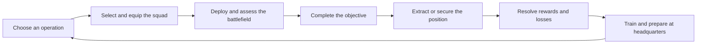
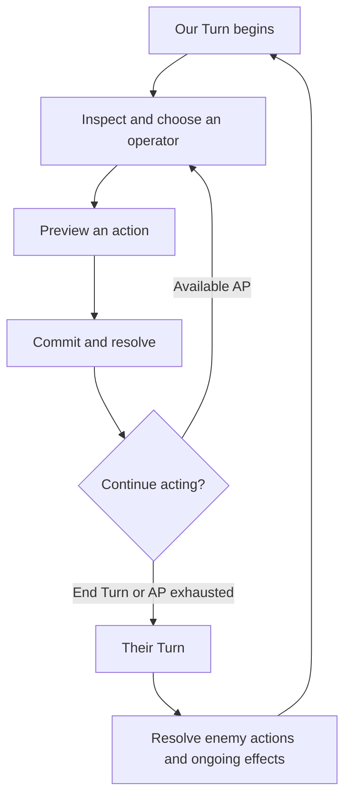
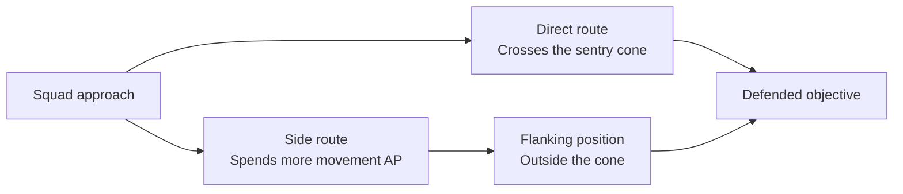

# Ring Wars Game Design Document

Last updated: 2026-10-19

Status: Draft

Command an elite resistance squad through surgical strikes against the occupation of Marendel. Choose the team, find the angle, complete the objective, and bring your operators home.

**Contents**

1. [Executive Summary](#executive-summary)
2. [Player experience and design pillars](#player-experience-and-design-pillars)
3. [Game Mechanics](#game-mechanics)
   - [Core loop and example of play](#core-loop-and-example-of-play)
   - [Tactical combat](#tactical-combat)
   - [Operators and squad composition](#operators-and-squad-composition)
   - [Enemies and encounter design](#enemies-and-encounter-design)
   - [Missions and tactical spaces](#missions-and-tactical-spaces)
   - [Campaign and headquarters](#campaign-and-headquarters)
   - [Progression and economy](#progression-and-economy)
4. [Setting and narrative](#setting-and-narrative)
5. [Art audio and presentation](#art-audio-and-presentation)
6. [Interface controls and learning](#interface-controls-and-learning)
7. [AI Architecture](#ai-architecture)
8. [Technical Strategy](#technical-strategy)

## Executive Summary

Ring Wars is a singleplayer, turn-based tactical squad shooter set in the Iris Expanse. The player commands a standard squad of **4 operators** drawn from a growing resistance roster. Each mission asks the player to turn a small force's superior training and specialized equipment into a decisive local advantage against a much larger Directorate garrison.

The campaign follows the Nova resistance on Marendel. Raids on communications, power, supply routes, prisons, and command facilities gradually dismantle the occupation. Between operations, the player returns to headquarters to choose missions, prepare operators, buy equipment, and train new abilities.

Combat centers on positioning, action points, and the interaction between different kits. Valid attacks hit, with damage varying within a visible range. Directional cover, armor, distance, visibility, and enemy control cones shape the value of each action. The player builds a plan from readable consequences, then adjusts as the battlefield changes.

| Element | Design |
|---|---|
| Genre | Turn-based tactical squad shooter |
| Format | Singleplayer campaign |
| Platforms | Windows and macOS |
| Controls | Mouse and keyboard |
| Perspective | Elevated 3D battlefield with a free tactical camera and directed action shots |
| Standard squad | 4 operators |
| Campaign structure | Authored story operations, mission choices, and generated side missions |
| Persistent development | Operator training, equipment, appearance, roster growth, and campaign progress |

The intended audience enjoys planning coordinated turns, experimenting with squad composition, and developing recognizable characters over a campaign. The experience rewards both attachment to a regular team and the deliberate use of specialists for a particular operation.

The distinctive appeal is the combination of a capable, outnumbered squad; reliable attacks with meaningful positional consequences; objective-driven raids that become withdrawals; and a campaign in which new equipment is found through the resistance's own operations.

## Player experience and design pillars

### Elite operators under pressure

Operators are individually formidable. A well-positioned specialist can break an enemy position, cover a withdrawal, or create the opening that the rest of the team needs. Their strength encourages bold action.

Enemy numbers, overlapping threats, and limited actions make that strength conditional on good decisions. An exposed operator can take concentrated fire. A powerful attack can leave its user poorly placed for the response. The desired feeling is confidence in the squad's capabilities and respect for the danger around it.

### Readable tactical decisions

The battlefield provides enough information to support a plan: reachable destinations, movement costs, damage ranges, cover directions, visible enemies, and threatened areas. Each preview connects the proposed action to its likely tactical consequence.

Uncertainty comes from damage variation, unexplored space, and the opposition's response. The player should be able to explain a successful maneuver and understand the mistake behind a failed one. Good decisions include securing a reliable finish, preserving a route, spending an ability to save an action, and accepting exposure to reach a decisive objective.

### A squad with an identity

An operator's callsign, appearance, training, and mission history make them recognizable. Their kit gives them a battlefield role, while their learned abilities reflect the player's investment. Familiar operators become the people the player wants to bring home.

The roster supports several ways to build that attachment. A player can develop a regular squad, maintain a bench of specialists, or explore different looks and imagined backstories. Practical preparation and personal expression meet in the same characters.

### Raids that advance the resistance

Mission goals have consequences beyond the immediate firefight. Rescue brings people into the resistance. Captured weapons create new loadout options. Destroyed infrastructure weakens the occupation's position. Progress is expressed through operations, locations, and usable capabilities.

The campaign alternates the pressure of a mission with the quieter decisions at headquarters. Each return gives the player a chance to use what the previous operation achieved and prepare for the next opportunity.

## Game Mechanics

### Core loop and example of play

#### Campaign loop

The War Table presents the current story operation or choice of operations alongside available side missions. The player considers the objective, known conditions, and rewards, then chooses a squad and equips it for the job.

On deployment, the player reads the space, finds a route, and uses coordinated turns to reach the objective. Completing the job often opens extraction and brings sustained reinforcement pressure. The squad withdraws, the mission result is resolved, and the player returns to headquarters with the consequences.

#### Decisions within a turn

During Our Turn, the player can alternate between operators and spend their available action points in the order that best serves the plan. A useful sequence might open a firing angle, remove an enemy who covers a crossing, move an objective specialist through that crossing, and reserve reaction fire for the enemy response.

Each action changes the next decision. Destroying cover changes the value of a firing position. A damage result can make a follow-up shot worthwhile. A newly revealed enemy can turn an apparently safe route into an exposed one. The player can reassess between actions.

#### Example operation

Consider a generated **Supply Sabotage** mission with an additional cache objective. The primary task is to plant demolition charges on a Directorate stockpile and extract. The cache offers a useful detour. This example shows a representative set of decisions within that mission structure.

**Preparation.** The player selects an Assault Rifle operator to cover movement, a Shock Sword operator to exploit close approaches, a Sniper to work a long firing lane, and a Medic to support the team. Frag grenades provide an answer to clustered defenders; smoke offers concealment during repositioning. The squad is prepared for a raid with a withdrawal ahead of it.

**Approach.** A sentry covers the direct route to the stockpile. The player inspects the cone and movement preview before committing. A side route costs more movement, but reaches an angle outside the sentry's threatened area. The Rifle operator watches an enemy approach while the Sword operator moves toward that flank.

**Breaking the position.** The Sniper targets an exposed defender. The player uses the resulting damage to decide whether another operator should finish that enemy or spend their actions advancing. From the flank, the Sword operator can threaten the sentry without crossing its cone. The squad creates enough room for someone to reach the stockpile controls.

**Changing the plan.** An enemy grenade marks part of the squad's position for a delayed blast. Moving now preserves health but changes the attack plan. The player redirects the threatened operators, keeps the Medic within a useful support route, and chooses which firing lane matters most for the next enemy phase.

**Completing the job.** The charges are planted. Extraction becomes the immediate goal as reinforcements arrive through the site's approaches. The optional cache is still a choice: the player weighs its reward against the distance and pressure it adds to the withdrawal.

**Withdrawal.** Smoke conceals a crossing, and the Rifle operator covers the route behind the squad. If an operator is Downed, the player must create the time and access needed to revive them before continuing the extraction. The mission concludes when the squad has reached the extraction zone or the player has explicitly committed to leaving an operator behind.

**Return.** Earned equipment and credits support the next preparation. Mission experience contributes to training, and a completed side mission is removed from the current set of offers. The player's choices have affected both the immediate result and the resources available for the campaign.

### Tactical combat

#### Turn structure and action points

Combat alternates between **Our Turn** and **Their Turn**. The player controls the squad during Our Turn; the Directorate carries out its actions during Their Turn.

Action points, or AP, are the common budget for movement, attacks, abilities, and objective interactions. Available AP depends on the operator's kit and applicable training or squad benefits. The player can act with operators in any order and return to an operator who still has actions available. Moving, attacking, and moving again are valid parts of a turn.

End Turn commits the squad to the enemy response. Remaining AP is spent deliberately or forfeited. Abilities that grant AP create opportunities to extend a maneuver before that commitment.

#### Movement and elevation

Movement uses free positions along traversable routes. The preview displays the planned path and the AP bands it crosses. The cost follows the path distance, including travel around obstacles and between accessible elevations. Splitting movement into separate orders spends AP for each move, so the player considers how much flexibility a short reposition is worth.

Waypoints let the player choose a route around a dangerous lane or obstacle. Occupied positions constrain movement and make squad spacing important. Ladders connect ground and rooftop play, adding useful firing positions and additional approaches to defend.

Movement is a tactical action because the route matters as much as the destination. Crossing a control cone can trigger a response on the way. A sheltered endpoint is useful only if the operator can reach it safely.

#### Attacks and damage

A valid attack hits. The damage preview shows the range of health damage the target can receive after protection is considered. As a ranged weapon approaches its maximum range, the upper end of its damage narrows. Distance therefore affects the value of the shot while the player can still reason about its minimum result.

Damage passes through directional cover, then armor, then health. Weapon characteristics and learned abilities can change how an attack deals with those protections. Multiple smaller attacks and a powerful armor-piercing attack can have different value against the same target because protection applies to each hit.

The player can attack as often as the chosen action's AP cost and use limits allow. Area attacks affect damageable units within their blast, including friendly operators. Their placement is both an offensive choice and a responsibility to the squad.

#### Melee and approach routes

Melee attacks require an operator to reach striking distance. The player can preview an approach with the AP needed for the strike reserved, linking the movement decision to the attack it enables. Enemy control cones and occupied routes can make that approach dangerous even when the target is close.

A melee strike bypasses directional cover while armor continues to protect the target. The Shock Sword therefore offers a different answer to an entrenched position: create access to the defender, then use the operator's close-assault capabilities to exploit it.

#### Cover and destruction

Cover belongs to scenery and protects from particular directions. A barrier between attacker and target can absorb damage; an attack from another angle can bypass that protection. Shield indicators communicate where protection applies.

Destructible cover loses durability when it absorbs fire or is hit by an explosion. A protected position can become exposed during the encounter. This makes concentrated fire and demolition useful for changing the space as well as damaging its occupants.

Armor travels with the unit, while cover depends on the relationship between the unit, the scenery, and the attack's origin. Flanking, removing a barrier, and bringing a weapon suited to the target are distinct ways to solve a defended position.

#### Visibility and concealment

Solid geometry blocks direct lines of sight. Elevation can provide a view over lower obstacles, and roof cutaways keep the currently viewed interior readable. The player discovers enemy positions through the squad's changing view of the battlefield.

Smoke conceals positions and blocks sight through its area. Camouflage supports concealed repositioning, with an attack breaking the concealment. These tools let the player alter which engagements are possible and create safer routes through exposed spaces.

Grenades follow a lobbed trajectory. The player considers the throw arc, landing point, affected area, and nearby friendlies before committing. Obstacles that interrupt direct fire can leave a useful arc over a position.

#### Overwatch and Suppressing Fire

Control cones turn a firing position into a threatened area. Their shape narrows with aim distance, and solid walls cut off the visible coverage. Both the squad and the enemy can use control to influence movement.

**Overwatch** converts committed AP into reaction-fire opportunities. An enemy entering the cone or spending AP within it can trigger a normal weapon attack. The shot follows the weapon's damage, cover, armor, and range rules. A target that remains standing can continue its movement after the reaction.

**Suppressing Fire** controls movement by stopping enemies moving through its cone. It is useful for holding an approach, delaying an enemy advance, or giving another operator room to act. Its role is distinct from the damage dealt by a Minigun's direct attack.

The player counters a cone by changing the engagement: moving around its coverage, approaching through blocked sightlines, using concealment, or dealing with the watcher from a safer position.

This tactical choice exchanges movement efficiency for a different engagement angle. Cover, the squad's remaining actions, and other enemy positions determine whether the longer route is worthwhile.

#### Healing and Downed operators

Health measures how much damage a unit can sustain. A Directorate enemy at zero health dies. An operator at zero health becomes **Downed** and needs revival to stand and act again.

Operators have access to a shared Revive action. Reaching the Downed operator and committing AP creates a rescue problem within the current encounter. Medic training can improve the squad's options, including revival at a distance. Medkits and the Medic's Stim restore health to standing operators.

Health recovers between missions. Bringing a Downed operator home requires revival and a successful withdrawal, as described in [Extraction and securing a position](#extraction-and-securing-a-position).

### Operators and squad composition

#### Roster and deployment

The player maintains a roster and selects **4 operators** for a standard mission. The opening escape introduces a single prisoner before the campaign expands into squad command. Later roster growth provides room for reserves and alternative specialists.

Operators are highly trained resistance personnel. Their battlefield capabilities come from their equipped kit, training, gear, and upgrades. Preparation begins with the mission's job: the player chooses the combination of mobility, firepower, support, and control that can accomplish it.

A regular squad develops familiar combinations. A broader roster gives the player more ways to solve unusual conditions or pursue a different style of play. Equipment ownership and allocation make the final loadout a concrete preparation decision.

#### Kits and tactical roles

A **Kit** defines the operator's basic attack, characteristics, and available specialist actions. Some kits are centered on a weapon; support kits combine a signature tool with a sidearm.

| Kit | Tactical role |
|---|---|
| Assault Rifle | Flexible frontline fire and Overwatch to cover routes and support an advance |
| Shock Sword | Close assault that rewards finding a safe approach and reaching an enemy's flank |
| Sniper | Precision fire over long lanes, supported by camouflage for repositioning |
| Minigun | Heavy direct fire and Suppressing Fire to control enemy movement |
| Grenade Launcher | Explosive support that threatens groups and defended positions |
| Medic | Health recovery, access to wounded teammates, and advanced rescue support |
| Captain | Coordination through target marking and trained command abilities |
| Pistol | A compact direct-fire kit and the sidearm used alongside specialist tools |
| Warmech | A supplied powered combat suit for selected heavy assault operations |

The roles create useful dependencies. A Rifle operator can protect the approach a Sword operator needs. A Medic can restore the operator holding an important position. A Captain can use command abilities to extend a teammate's opportunity. Squad composition determines which combinations the player can bring to the battlefield.

#### Gear and upgrades

Gear adds tools such as medkits, frag grenades, and smoke grenades. Limited mission uses make the timing of each use important. A grenade can save several attacks against a group, while a smoke screen can preserve the route that makes extraction possible. Gear uses refresh for the next mission.

Upgrades adjust equipment performance and operator characteristics. Ammunition can improve attacks against armor or add an effect; plating can improve protection; movement equipment can support faster repositioning. The player considers the interaction with the operator's kit and training when allocating the available equipment.

Some operations supply mission-specific equipment. That equipment serves the operation's scenario while the operator's prepared loadout remains available for their return to normal deployment.

#### Appearance and personal identity

Operators have editable callsigns and appearances. Players can choose body type and height, face, skin tone, eye color, hair, outfit pieces, and available skins. Equipment and clothing fit across the body options. Kit equipment can add distinctive worn pieces, including a helmet whose visibility the player can control.

Appearance is personal expression. Its choices are independent of combat effectiveness. Randomized recruits arrive with a usable identity and can be customized immediately, allowing the player to invest as much attention in their look as they enjoy.

The squad's appearance should remain recognizable in portraits, the headquarters lineup, and battlefield shots. Individuality is especially important against the Directorate's uniform troops.

#### Recruitment and loss

Campaign milestones expand the roster. Recruits receive a training foundation based on story progress, giving them a useful place alongside established operators. The player can then shape their specialization.

An operator lost during extraction leaves the active roster. A memorial preserves their identity and the mission in which they were lost. Recruitment fills the available roster space, while the loss of a familiar operator remains a personal consequence of the withdrawal.

### Enemies and encounter design

#### Directorate opposition

The Directorate fields a large garrison against the squad's small deployed force. Most opposition is less capable than an individual operator, while elites and mission-specific commanders introduce stronger threats. Enemy weapons draw on recognizable kit roles, helping the player read what a unit can do.

An encounter's danger comes from the relationship between enemies: a sentry watching a crossing, riflemen supporting it from cover, or a close-assault unit threatening an operator who moves too far ahead. Identifying which part of that arrangement to break is a central tactical decision.

| Threat | Pressure on the player |
|---|---|
| Pistol troops | Close-range numbers and additional actions around a contested position |
| Rifle troops | Direct fire, usable range, and pressure on exposed operators |
| Sentries | Defended lanes and control cones that complicate a direct approach |
| Shock troops | Melee pressure that challenges spacing and demands attention to approach routes |
| Commanders and elites | Greater staying power or threat that gives the encounter a priority target |

#### Enemy behavior

Enemies assess the battlefield through their role and orders. They seek useful firing positions, protection, and opportunities to damage or Down operators. A defending unit values its assigned position differently from a unit advancing on the squad. Sight and remembered contact shape their response.

Good enemy behavior makes the space matter. A defender holds a valuable lane, a flanker looks for an exposed operator, and a threatened unit considers a safer position. Their actions should make sense in relation to what the player can see them trying to accomplish.

#### Grenades and forced movement

Enemy grenades create a delayed threat. The grenade marks its affected area on landing and explodes at the beginning of the next enemy turn. The player gets a response window in which to reposition.

That response changes the value of other actions. A squad may have to abandon cover, interrupt an attack, or find room for a wounded operator along a shared escape route. The blast zone communicates the problem clearly, and the surrounding encounter determines how difficult the solution is.

#### Reinforcement pressure and difficulty

Reinforcements enter through believable exterior approaches. Their arrival links the playable area to the occupied facility around it and changes which routes are safe.

Difficulty grows through enemy composition, overlapping lanes, approach geometry, protection, reinforcement pressure, and the demands of the objective. Rifle Overwatch is used sparingly in gentler encounters so that the player can learn to recognize and counter it. More demanding encounters combine established threats and ask the player to coordinate the squad's answers.

### Missions and tactical spaces

#### Objective structure

Most operations send the squad into a site to do a specific job and leave. Tasks include accessing a console, destroying controls, planting charges, taking supplies, rescuing people, escorting them, or holding a position while an operation completes.

An objective changes how the player values space and AP. Holding controls asks the squad to protect a location. Escort creates a moving responsibility. Demolition demands access to the target and a route away from it. The briefing and markers identify the task; the level creates the tactical problem around it.

Optional objectives add a choice within the operation. Their rewards can justify a detour, but the player must account for distance, remaining resources, and the current threat. An optional cache becomes especially consequential when pursuing it changes the squad's withdrawal.

#### Extraction and securing a position

Objective completion commonly begins the withdrawal. Continued enemy reinforcements give the squad a reason to leave the site, and movement, concealment, and covering actions become as important as the damage already dealt.

Standing operators extract by entering the extraction zone. Once someone reaches the zone, the player can explicitly commit to leaving another standing operator behind. The mission concludes when all standing operators are accounted for by extraction or that decision. Any operator still outside the zone, including a Downed operator, is lost when the successful extraction concludes.

Some milestone operations require the squad to defeat the defending force and secure the location. These encounters support moments such as taking a base, stopping a counterattack, or defeating an occupation commander. Their ending reflects control of the position.

If the whole squad is Downed, the mission fails. The operation remains available for another attempt. Successful completion advances its campaign consequences; failure returns the player to the preparation and mission choices needed for a new attempt.

#### Tactical layout

Playable spaces provide readable approaches, meaningful cover, and room to maneuver. Ground routes, interiors, service lanes, and accessible rooftops create different relationships between movement and sight. A useful position supports a task: covering an approach, reaching an objective, protecting an escort, or securing a withdrawal.

The player should be able to find more than one useful way through a position. A short exposed crossing, a longer sheltered route, and an elevated firing angle can each serve a different squad or AP budget. Cover placement and enemy deployment make those alternatives tactically distinct.

The facility continues beyond the mission perimeter through scenery, service roads, and distant structures. Reinforcement approaches belong to that larger place. Tall surroundings frame the site while leaving the tactical camera a clear view of the playable area.

#### Authored and generated operations

Authored story missions pair a specific location and scenario with the campaign's important events. Their layout, objectives, discoveries, and teaching moments support that event's role in the player's experience.

Generated side missions combine hand-authored spatial blocks into a complete tactical site. Variation changes routes, approach angles, objectives, cover decisions, and enemy placement while retaining a coherent facility. Each offered mission retains its setup across retries so the player can apply what they learned from the previous attempt.

Side-mission types include recovering supplies, gathering field intelligence, opening a weapons cache, and sabotaging a stockpile. Modifiers can introduce an additional cache or a more demanding enemy presence. Variety comes from the combination of job, space, and opposition.

#### Pacing

A mission moves through approach, commitment, objective pressure, and resolution. Early contact establishes the threat. The main position asks for coordinated action. Completing the objective changes the squad's immediate priorities, and extraction tests whether the player preserved a workable way out.

The intended rhythm keeps each encounter purposeful. Advancing the objective, repositioning, and responding to danger should continue to change the player's decisions throughout the operation.

### Campaign and headquarters

#### Campaign arc

The campaign develops from escape and an initial foothold into a sustained resistance operation, then a push into the capital. Each act introduces a different scale of opportunity while keeping the squad's role focused on decisive local actions.

| Act | Campaign movement | Representative operations |
|---|---|---|
| A foothold | Escape captivity, establish headquarters, and isolate the occupation | Breakout; A Place to Stand; Dead Air; Sever the Ring |
| Build the resistance | Capture resources, rescue useful people, and equip the growing network | Follow the Freight; rescue and weapons choices; Hold What We Took |
| Drive them back | Open routes, remove supporting fire, and dismantle the garrison's remaining positions | Keep the Crossing; Silence the Guns; Empty Their Shelves; Break the Line |
| The capital | Enter the defended city, take heavy equipment, open headquarters access, and defeat occupation command | Under the Wall; Keys to the Giants; Break the Bastion; Their Last Order |

The player's contribution is expressed in the targets the squad reaches and the opportunities those successes open. The larger resistance benefits from the squad's operations, while the player's decisions remain grounded in the people and equipment they command.

#### Mission choices

Some story steps present mutually exclusive operations. Completing one advances the campaign and closes the other opportunity. The player chooses a useful outcome in the context of the resistance's current needs.

| Choice | Consequence |
|---|---|
| Open the Cages or Take the Assembly Line | Rescue civilians and skilled workers, or secure local weapons production |
| Long Reach or Heavy Hands | Acquire precision weapons or heavy fire support |
| Fuel for the Fire or Hard Shell | Secure mobility equipment or improved protective equipment |
| Bring Them Home or Chain of Command | Restore a medical team or recover a field commander, opening the corresponding support kit |

These choices influence preparation and the way the player experiences later missions. Side operations supply additional equipment and resources around the selected campaign path.

#### Headquarters

Headquarters becomes available after the resistance takes its initial base. It is a physical place that connects the campaign's recurring decisions.

The **Barracks** presents the roster and operators. The player selects the deployed squad, changes equipment and appearance, and spends earned experience on training. The lineup makes the team visible as people between operations.

The **Armoury** sells discovered equipment and available skins. Purchases expand the supply of equipment the player can allocate across the roster. Item presentation pairs a recognizable object with its function, ownership, and purchase cost.

The **War Table** presents operations in their geographical and campaign context. It connects the next objective to the progress already made and leads into squad preparation and deployment.

The headquarters training space supports individual practice and optional solo challenges. These activities provide focused ways to play and earn their associated rewards.

#### Persistence and return

Campaign progress, operator development, appearance, equipment ownership, and purchases persist between visits. The main menu lets the player create a named campaign or continue an existing one.

A mission's conclusion resolves its rewards and losses before the player prepares again. This keeps the headquarters loop tied to completed operations and gives each return a clear set of consequences to consider.

### Progression and economy

#### Experience and kit training

Operators bank experience and spend it on ordered training steps within unlocked kit lines. Training adds concrete capabilities: improved attacks, movement, resilience, control, healing, or a specialist action. Each learned step changes how the operator can contribute.

Training can change the squad's plan as well as its damage output. The Captain's Field Orders grants another operator AP to extend a maneuver. The Medic's Rescue revives a Downed ally at range. The Sniper's Deadeye commits to a powerful shot through armor and cover. Advanced area attacks, including Sweeping Fire, Airburst, and Orbital Strike, give their operators new ways to break a defended position while requiring care around friendlies.

The progression interface presents learned and available capabilities directly. The player judges an operator through their kit, equipment, and training rather than a single overall level. Choosing someone for the job remains meaningful throughout the campaign.

Specialization and breadth serve different purposes. Deep training makes an operator more capable within a chosen role. Training across kits provides more preparation options as objectives and available equipment change. Story rewards provide a foundation across the roster, while additional successful operations and optional objectives support further development.

#### Campaign discovery

New equipment enters the player's experience through the campaign. A weapons raid introduces its captured kit. A rescued team opens a related support capability. A logistical success provides equipment or resources with a clear place in the resistance's work.

An unlock can provide equipment and make additional copies available in the Armoury. Other rewards grant access, extra copies, improvements shared across the roster, or cosmetic options. Mission-supplied equipment supports specific scenarios, including the Warmech assault.

Discovery also shapes the interface. The player's equipment choices expand as capabilities become available, so preparing a newly equipped operator is part of understanding the reward.

#### Credits and equipment ownership

Credits come from successful operations and their applicable rewards. The Armoury turns them into additional equipment and available cosmetic purchases. Owned equipment is allocated to operators, making the number of available copies relevant when several people need the same item.

Story progression is intended to outfit a standard squad. Side missions support spare equipment, a larger working roster, and alternative builds. Their rewards give the player reasons to explore the current operation set and broaden the team's options.

Random equipment rewards draw from appropriate discovered items. This reinforces the equipment vocabulary the player has already encountered and adds variety to preparation. Skins can also be earned through achievements or bought where available.

#### Progression pace

The story path should support a focused operator's development through a kit line by the later campaign. Optional objectives and side missions can accelerate that investment or fund broader training.

Roster growth and recruitment use story progress as a foundation. The player can introduce a specialist later in the campaign and make productive choices for them immediately. Experienced operators retain the value of their additional investment and the identity accumulated through play.

## Setting and narrative

### Marendel and the occupation

The Iris Expanse is a human science-fiction setting with a hint of fantasy. Ring Wars centers on Marendel, a settled world of working facilities, logistics networks, service routes, and occupied towns. The occupation is visible in the places people depend on and in the force controlling them.

Nova's resistance grows from the Directorate's own logistics organization. Its leaders built the network while outwardly serving the occupation. The campaign begins as that resistance starts acting openly, and the player becomes one of its skilled operators.

The contrast is practical and immediate: a small force knows how the system works and attacks the facilities that sustain it. The Directorate has numbers, equipment, and entrenched positions. The resistance turns access, local knowledge, and precise action into opportunities.

### The Ring and the stakes of isolation

The Ring is the connection between Marendel's system and the wider network of inhabited space. The opening strikes attack the communications relays and the power infrastructure supporting that connection. Severing it isolates the Directorate garrison and changes the conditions of the conflict.

The campaign then follows the local struggle: capture supplies, recover people, interrupt enemy movement, and force the occupation back toward its center. The squad's successes are specific enough to understand as individual missions and cumulative enough to change the campaign.

The final movement brings those capabilities into the capital. Access, captured machinery, and the defeat of command resolve the struggle for Marendel through the same kind of targeted action that began it.

### Story delivery

Mission openings establish the immediate situation, the job, and the equipment the squad is using. Briefings and objective markers keep the player's current purpose clear. Dialogue and directed shots give important moments a point of view while gameplay carries the choices that follow.

The environment reinforces the campaign's progress. Early operations move through utilitarian facilities occupied by the Directorate. Later locations bring the squad closer to the capital's wealth and ornament. The change in setting makes the campaign's advance visible.

Operator identities remain open to the player's interpretation. Callsigns, appearance, specialization, and the circumstances of survival or loss create personal stories within the authored resistance campaign.

## Art audio and presentation

### Visual direction

Marendel's working world is functional and recognizable as something people built to use. Concrete, gunmetal, rugged vehicles, service infrastructure, and restrained accents establish the material vocabulary. Places show use, care, and the arrangement of real work.

The resistance wears practical special-operations equipment. Navy and blue connect its operators to Nova's logistical origins, with orange on working parts. Individual appearances and useful equipment make the squad distinctive within a shared military language.

Directorate troops read as uniform and immaculate. Silver and red identify the line troops; polished gold distinguishes officers. The capital expresses the occupation's privilege through art deco architecture, elaborate doors, polished surfaces, and ornament.

Weapons fire projectiles. Visible mechanisms, muzzle flashes, impacts, and recoil connect their behavior to the equipment in an operator's hands. Light and luminous details have a functional reason within the scene.

### Space and readability

The tactical view must make routes, units, cover, and important interactions easy to distinguish. Lighting gives figures and scenery readable form while preserving useful shadow detail. Objective and threat overlays sit clearly against the environment.

Architecture can be precise, while people, parked vehicles, equipment, and loose stock follow the uneven arrangement of use. This supports the sense of a working place and gives the player believable tactical obstacles.

Equipment presentation uses grounded objects, dark textured backgrounds, and restrained studio lighting. The same item should feel recognizable when seen as an Armoury image, a loadout choice, and part of the deployed operator.

### Camera and action feedback

The free camera lets the player inspect the battlefield, change angle, zoom between overview and closer framing, and examine accessible elevations. Interior cutaways reveal the space the player needs to understand.

Directed action shots bring the camera closer for targeting, movement, attacks, and important enemy actions. Their job is to show what the operator is doing and what the action achieved. The tactical view remains the place from which the player makes the next decision.

Animation, recoil, muzzle flashes, projectiles, impacts, cover damage, and hit reactions make an attack legible as a physical event. Health and AP feedback connect that event to its tactical result. Death, Downed states, revival, and extraction each need a recognizable presentation.

### Sound and music

Gunfire communicates the weapon's character and the weight of an engagement. Impacts, explosions, footsteps, doors, and machinery establish the action's location and material context. UI sounds acknowledge selection, commitment, and failure to carry out an order.

Voice and radio dialogue carry briefings and mission moments. The mix gives spoken information room when it matters, while the combat remains audible as the action around it. Music supports the atmosphere of the menu, headquarters, and individual operations.

Master, music, sound effects, and voiceover volume can be adjusted separately. Players can balance atmosphere, action, and dialogue for their listening conditions.

## Interface controls and learning

### Information hierarchy

The interface supports the decision immediately in front of the player. Mission objectives occupy a distinct place from action feedback. The selected operator exposes their remaining actions and relevant capabilities. Aiming and movement replace general information with the previews needed to commit an order.

World indicators identify objectives, extraction, movement, range, cover, and control cones. Their placement relates the rule to the space where it applies. Text, icons, shapes, and world positioning work together to explain state.

Equipment and training screens keep names, effects, comparisons, ownership, and cost close to the corresponding decision. Concise words such as **Kit**, **Gear**, **Speed**, **Learned**, and **Train** provide a consistent vocabulary.

### Interaction and controls

Mouse interaction is the primary way to select a unit, inspect a target, choose a destination, and commit an action. Keyboard shortcuts support frequent decisions and camera movement.

| Interaction | Control |
|---|---|
| Select an operator or visible unit | Click the unit or its interface representation |
| Choose an action | Click its action control or use its displayed number shortcut |
| Move | Select Move, inspect the path, and click a destination |
| Shape a movement route | Add waypoints with right-click while plotting movement |
| Aim and commit | Choose the action, inspect the target or area preview, and confirm with a click or Space |
| Cycle operators or targets | Tab, according to the current selection state |
| Cancel or go back | Escape |
| Pan the battlefield | WASD or movement at the screen edge |
| Orbit the camera | Hold and drag the right mouse button |
| Zoom | Mouse wheel |
| Change the viewed floor | Page Up and Page Down where rooftop play is available |
| End the squad's turn | End Turn control or its hold-Space interaction |

Input context distinguishes a route waypoint from a camera drag and an action confirmation from End Turn. Previews remain visible while the player evaluates the order. A rejected action gives a concise reason tied to the attempted move, target, resource, or line of sight.

### Learning through the campaign

The opening escape, **Breakout**, introduces movement and cover through an unarmed prisoner crossing a dangerous space. Its limited responsibilities let the player learn how to read a route and survive an enemy response.

**A Place to Stand** introduces standard squad combat and Overwatch while establishing the resistance's headquarters. **Dead Air** develops the use of firing angles and control cones. Its rewards open the Shock Sword kit. **Sever the Ring** asks the player to combine the opening lessons with a squad and loadout they have prepared.

Later operations introduce capabilities through their objectives and rewards. A newly captured weapon or rescued specialist arrives with a reason to try a different preparation. The player learns the growing set of options through encounters that give those options a useful job.

### Accessibility and player comfort

Our Turn gives the player time to inspect the battlefield and consider orders. Movement paths, damage previews, world markers, and control cones reduce the need to remember information that the game can show at the point of decision.

Readable silhouettes, clear text, recognizable icons, and distinct Downed and action states support understanding across camera distances. Important information should remain understandable from the combined visual cues and written feedback. Players can adjust the opacity of in-world indicators to suit their view of the battlefield.

The camera supports both an overview of the tactical problem and closer inspection of the squad. Performance and display settings let the player choose an appropriate presentation for their machine. The interface keeps the mission, the operator, and the consequence of the next action in view.

## AI Architecture

### Development agents and gameplay

Ring Wars uses specialized AI agents as a development crew. They turn mission briefs, dialogue, design changes, and playtest findings into game content and verified changes. Their work becomes the locations, performances, encounters, and working interactions the player experiences.

Unity executes the tactical rules and enemy behavior described in [Game Mechanics](#game-mechanics). Generated side missions assemble authored spatial blocks and encounter definitions. Development agents produce those building blocks and check the resulting missions before they reach the player.

| Agent | Development role and effect on play |
|---|---|
| Voiceover Agent | When approved dialogue changes, this agent generates and integrates the spoken lines so the player hears the mission briefing or exchange with the corresponding subtitles. |
| Level Designer Agent | When a mission brief is ready, this agent designs its routes, objectives, cover, and visual references so the player faces useful choices about approaching the target and getting the squad out. |
| Level Builder Agent | When a level design is approved, this agent sources assets and builds the playable location so the player can move, fight, use cover, and complete objectives inside a coherent Marendel facility. |
| Balance Agent | When a kit, encounter, reward, or playtest finding needs adjustment, this agent revises the relevant game definitions so the player has useful squad choices and encounters that reward coordinated action. |
| Testing Agent | When a playable change is ready, this agent checks the affected path and reports reproducible failures so the player can deploy, complete the mission, extract, and use the resulting rewards. |

Jim sets priorities, approves creative direction, and judges visual quality, timing, and feel through play. Each agent owns a bounded task within its specialty and returns the result through the contract in [Technical Strategy](#technical-strategy).

### One Wow agent

The **Level Builder Agent** has the most visible output. It turns a tactical plan into the place the player inhabits: a working supply depot, occupied relay, or defended capital approach. Routes, sightlines, destructible cover, lighting, materials, and surrounding scenery must work together from both the tactical camera and the closer action shots.

For a Supply Sabotage mission, its success is visible when the player can read the stockpile, spot a protected approach, recognize a useful firing position, and understand the route to extraction. The location carries Marendel's identity while supporting those decisions.

## Technical Strategy

### Production foundation and course scope

Ring Wars is built in **Unity 6 with URP**, using C# gameplay systems and editable content definitions. Blender supports environment construction and character preparation. Imported assets, generated media, and authored mission content become ordinary project assets that can be inspected and revised in the existing tools.

The eight-week course builds on the existing game through playable slices. A mission slice connects a brief, tactical layout, built environment, encounters, objectives, dialogue, and a checked result back at headquarters. Work proceeds through that complete path so a new scene or system change contributes to the game the player can play.

### Prose input and structured results

Each agent accepts a prose brief containing the task, relevant game context, source references, constraints, and the result Jim needs. The brief can include images, layout files, dialogue, or an observed problem. Existing specialist skills supply the procedures for carrying out the work.

Each agent returns a **structured JSON result manifest**. Prose remains useful inside its summary and findings; named fields make the handoff dependable. The common contract contains:

| Field | Purpose |
|---|---|
| Task and agent | Identify the assigned work and the specialist responsible. |
| Status | State whether the task is complete or needs input. |
| Summary | Explain the result in plain language. |
| Inputs | Reference the brief and source assets or definitions used. |
| Deliverables | Identify the resulting files, assets, or changed definitions. |
| Checks | Record what was exercised, the observed result, and supporting evidence. |
| Open questions | Identify any decision or missing input needed to continue. |

The manifest points to native artifacts such as audio clips, Blender files, Unity assets, and layout references. Model-native structured output is used where the selected tool supports it; the result is checked against the contract before handoff. Schema conformance establishes the result's shape. Asset inspection and gameplay checks establish whether the work succeeds. [OpenAI Structured Outputs](https://developers.openai.com/api/docs/guides/structured-outputs) provides schema-constrained responses for supported models.

### Specialist contracts

The shared manifest carries the following deliverables for each role. These define the handoff at a production level; the specialist skills own the detailed tool procedures.

| Agent | Prose brief and supporting input | Structured deliverables |
|---|---|---|
| Voiceover Agent | Approved lines, speaker identity, delivery direction, and the mission moment. | Line identifiers, generated clip references, subtitle associations, durations, and playback findings. |
| Level Designer Agent | Mission purpose, insertion and extraction needs, enemy roles, setting, and tactical constraints. | Layout and brief references, objective and route annotations, fixed-camera reference views, and layout check results. |
| Level Builder Agent | Approved layout and reference package, with the required look and usable asset sources. | Source asset references, Blender and Unity deliverables, and findings from import, navigation, cover, lighting, and playable-path checks. |
| Balance Agent | A specific kit, encounter, progression issue, or playtest observation, with its intended player experience. | Affected definition identifiers, the change set, and before-and-after observations from the relevant gameplay scenario. |
| Testing Agent | The changed feature or mission path and its expected player-visible behavior. | Check identifiers, expected and observed results, pass or fail status, and reproduction steps with evidence for failures. |

For a new mission, the Level Designer's package feeds the Level Builder. Voiceover work uses the approved dialogue associated with that mission. Balance work responds to the playable encounter, and Testing checks the affected mission and headquarters path. A failed check returns to the specialist responsible for that part of the work. Jim reviews the playable result and directs the next iteration.

### Biggest technical constraint

**Art production is the largest technical constraint.** A solo developer needs enough coherent environments, modular operators, equipment, animation, effects, and audio to sustain a tactical campaign. An environment must also support readable cover, destruction, navigation, cutaways, and close camera views.

Ring Wars addresses this through existing asset libraries and its established asset generation pipeline. Licensed environment, character, equipment, and animation packs provide reusable foundations. Shared Blender libraries, materials, and modular pieces carry that investment across missions. Generated concepts, fixed-camera level references, selected textures, and voice performances supply material suited to the game's specific needs.

Environment work starts with tactical geometry. A checked layout becomes a blockout and a set of fixed camera views; painted references guide asset selection and construction. The Level Builder assembles and adapts the selected pieces, then finishes navigation, cover, destruction, and lighting in Unity. Authored blocks can also enter the library used for generated side missions.

The visual direction in [Art audio and presentation](#art-audio-and-presentation) guides adaptation across asset sources. Jim reviews the results from the tactical and action cameras, where a successful asset must both belong to Marendel and make the player's next decision readable.

### Token budget

The initial planning estimate is **about 1,000,000 text-agent tokens per week**, or **8,000,000 across the eight-week course**. The following allowances describe bounded production tasks, including relevant context, tool interaction, and revision across multiple model calls.

| Agent task | Estimated total tokens |
|---|---:|
| Voiceover preparation and integration for one dialogue scene | 15,000 |
| Level design and reference pass for one mission | 80,000 |
| Level build and Unity integration pass for one mission | 160,000 |
| Focused balance pass on an encounter, kit, or reward path | 35,000 |
| Verification pass on the changed mission and campaign path | 30,000 |
| **Reference production cycle** | **320,000** |

Two reference cycles per week use about 640,000 tokens, leaving about 360,000 for integration, investigation, and rework. A cycle can revise an existing mission; it describes an iteration budget. Actual usage from the first cycles will refine the estimate.

These totals count input and output, including reasoning tokens where reported by the provider. They are task allowances across calls; each call must fit the selected model's own context and output limits. Provider usage records capture generated tokens beyond the visible response. [OpenAI Token Counting](https://developers.openai.com/api/docs/guides/token-counting)

Image generation and speech synthesis have separate request or credit costs and are tracked alongside text usage. Approved references, unchanged voice lines, and reusable assets are reused across iterations. Briefs include the relevant source material, and handoffs reference artifacts so each specialist can work with a focused context.

The gameplay budget is **zero generative-AI tokens per mission**: Unity runs the authored rules, enemy behavior, and mission assembly, and plays the imported media.

### API constraints

| Constraint | Effect on Ring Wars production |
|---|---|
| Text request and token limits | Agent calls share the connected account's applicable project and model limits. Scheduling uses those actual allowances, with bounded concurrent tasks and smaller focused calls when necessary. |
| Model context and output limits | A brief contains the relevant mission, definition, or asset references. Large tasks are divided into design, build, and verification passes whose results can be handed off without carrying an entire project transcript. |
| Structured response support | The chosen model and tool must support the required result format, and each handoff is checked before another agent consumes it. |
| Speech credits and concurrency | Voice generation runs by independently triggered line. Stable line identifiers and request fingerprints let the pipeline reuse an unchanged performance. Generation stays within the connected ElevenLabs account's credits and concurrent-request allowance. |
| Image generation quota and turnaround | References and particular textures are generated in focused batches that can be reviewed before construction. Approved outputs are retained as production inputs. |

OpenAI request and token limits vary by model and apply at the organization and project level; the connected account's limits determine available throughput. [OpenAI Rate Limits](https://developers.openai.com/api/docs/guides/rate-limits)

ElevenLabs can reject requests when rate or concurrency limits are reached. The production queue waits for capacity before continuing the affected voice work. [ElevenLabs API Errors](https://elevenlabs.io/docs/eleven-api/resources/errors)
